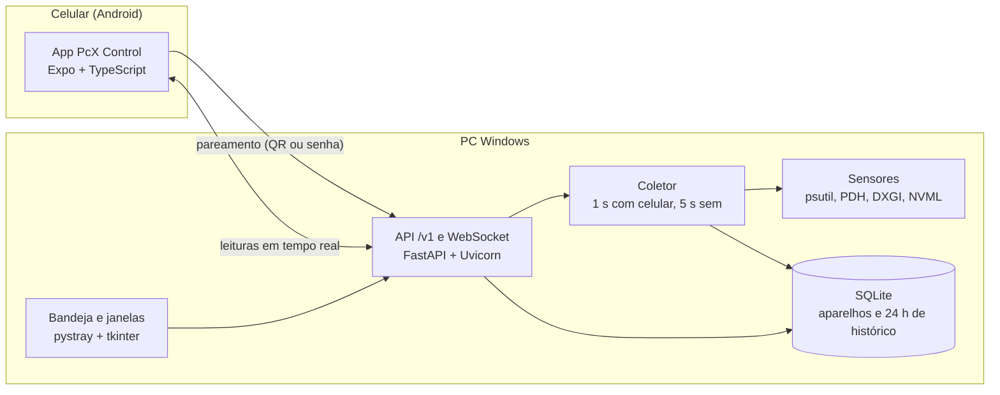

# PcX Control

> Turn your Android phone into a live sensor panel for your Windows PC. Pair in seconds with a QR code.

Transforme o celular Android em um painel de sensores do seu PC Windows, na rede local, com pareamento por QR code.

**Status:** em desenvolvimento. Agente **0.3.0** (instalador do Windows e ícone na bandeja) e app
Android **0.2.0**.

| Agente | App | Protocolo |
| --- | --- | --- |
| 0.3.0 | 0.2.0 | 1 |
| 0.2.0 | 0.2.0 | 1 |

## Como instalar

1. Baixe o `PcXControl-Setup-X.Y.Z.exe` na [última release do agente](https://github.com/Owaleee/PcX-Control-app/releases).
2. Instale e aceite o pedido de administrador (só para liberar o agente na rede **Privada**).
   Se recusar, a instalação termina normalmente, mas o celular só alcança o PC depois de criar
   a regra (plano B em [docs/teste-manual-app.md](docs/teste-manual-app.md)).
3. Crie a senha do PC no assistente que abre.
4. No celular, abra o app, toque em **Adicionar PC** e escaneie o QR code.

O PC e o celular precisam estar na mesma rede Wi-Fi, marcada como **Privada** no Windows.

> **Rede doméstica.** A conexão entre o celular e o PC ainda não é criptografada (HTTP). Use o
> PcX Control na sua rede de casa, não em Wi-Fi público. HTTPS está planejado.
>
> **Antivírus.** O executável é gerado pelo PyInstaller na CI pública do GitHub. Alguns antivírus
> desconfiam desse tipo de executável; se isso acontecer, confira a release e libere o arquivo.

## Arquitetura



## Experimentar o agente sem instalar (qualquer sistema)

```bash
cd agent
python -m venv .venv
.venv/bin/pip install -e ".[dev]"      # no Windows: .venv\Scripts\pip
.venv/bin/python -m pcx_agent --demo
```

Mais detalhes em [agent/README.md](agent/README.md).

## App Android

Veja [mobile/README.md](mobile/README.md) para rodar no Expo Go ou gerar o APK, e
[docs/teste-manual-app.md](docs/teste-manual-app.md) para o roteiro de teste com o PC.

## Documentação

| Documento | Conteúdo |
| --- | --- |
| [Especificação v1](docs/specs/2026-10-30-pcx-control-v1-design.md) | O que será construído e por quê |
| [Plano 1: agente](docs/plans/2026-10-30-plano-1-agente.md) | Tarefas, testes e ordem de implementação |
| [Plano 2: app](docs/plans/2026-11-01-plano-2-app.md) | Tarefas e testes do app Android |
| [Plano 3: Windows](docs/plans/2026-11-01-plano-3-windows.md) | Bandeja e instalador (agente 0.3.0) |
| [Protocolo](docs/protocolo.md) | Rotas, mensagens e códigos de fechamento |
| [Decisões e pendências](docs/decisoes-e-pendencias.md) | O que mudou no caminho e o que falta |
| [Changelog](CHANGELOG.md) | Histórico de versões |

Licença: [MIT](LICENSE).
