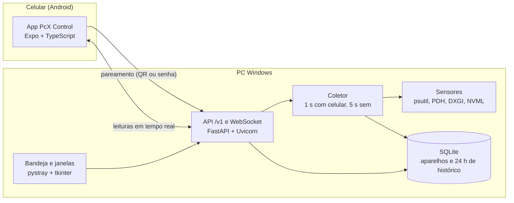

# PcX Control

> Turn your Android phone into a live sensor panel for your Windows PC. Pair in seconds with a QR code.
> Windows agent (Python, FastAPI, SQLite) + Android app (Expo, TypeScript), open source under MIT.

Transforme o celular Android em um painel de sensores do seu PC Windows, na rede local, com
pareamento por QR code.

**Versões atuais:** agente **0.4.0** (Windows) e app **0.3.0** (Android). Os dois conversam pelo
protocolo **1**.

| Agente | App | Protocolo |
| --- | --- | --- |
| 0.4.0 | 0.3.0 | 1 |
| 0.3.0 | 0.3.0 | 1 |
| 0.3.0 | 0.2.0 | 1 |

## O que ele faz

- **Painel no celular:** CPU, RAM (usada e livre), GPU (uso, VRAM e temperatura), rede e discos,
  com gráficos de 15 minutos, 1 hora e 24 horas.
- **Modo painel em paisagem:** tela sempre ligada, cartões grandes, um cartão só para a GPU e
  proteção contra burn-in. Tocar no cartão da GPU abre o histórico de uso, VRAM e temperatura.
- **Pareamento em segundos:** QR code ou IP e senha (o campo de IP coloca os pontos sozinho).
- **Temas** Escuro, Claro e AMOLED.
- **No PC:** instalador, ícone na bandeja, janelas de pareamento e de celulares pareados, aviso
  quando a rede está como Pública e log de cada pareamento e conexão.
- **Segurança:** senha só como hash, tokens por aparelho, um celular conectado por vez, limite de
  tentativas por IP e para a rede toda, firewall só na rede Privada.

## Baixar

| Parte | Onde |
| --- | --- |
| Agente para Windows | `PcXControl-Setup-X.Y.Z.exe` na [release do agente](https://github.com/Owaleee/PcX-Control-app/releases) |
| App Android | `.apk` na [release do app](https://github.com/Owaleee/PcX-Control-app/releases) |

## Como instalar

1. Instale o agente no PC e aceite o pedido de administrador. Ele só serve para liberar o
   PcX Control na rede **Privada**. Se recusar, a instalação termina normalmente, mas o celular
   só alcança o PC depois de criar a regra (veja "Solução de problemas").
2. Crie a senha do PC no assistente que abre.
3. Instale o APK no celular, abra o app e toque em **Adicionar PC**.
4. Escaneie o QR code, ou toque em **Digitar IP e senha** e use o endereço que aparece na janela.

O PC e o celular precisam estar **na mesma rede**, e a rede do PC precisa estar como **Privada**
no Windows. A janela de pareamento avisa quando não está.

> **Rede doméstica.** A conexão entre o celular e o PC ainda não é criptografada (HTTP). Use o
> PcX Control na sua rede de casa, não em Wi-Fi público. HTTPS está planejado.
>
> **Antivírus.** O executável é gerado pelo PyInstaller na CI pública do GitHub. Alguns antivírus
> desconfiam desse tipo de executável; se isso acontecer, confira a release e libere o arquivo.

## Solução de problemas

### "PC não encontrado" no celular

O celular não conseguiu chegar ao PC. Na ordem do mais comum:

1. **Rede Pública no Windows.** Em *Configurações › Rede e Internet*, abra a rede conectada
   (Wi-Fi ou Ethernet) e marque **Privada**. A janela de pareamento mostra esse aviso.
2. **Redes diferentes.** O celular precisa estar no mesmo Wi-Fi do roteador do PC, não no 4G nem
   numa rede de convidados (que costuma isolar os aparelhos).
3. **VPN no PC** (Radmin, Hamachi, ZeroTier, WireGuard). O agente reconhece as VPNs mais comuns
   pelo nome da placa ou pela faixa de IP e escolhe o IP da rede local, mas confira se o endereço
   na janela de pareamento é o do Wi-Fi ou Ethernet (geralmente `192.168.x.x`). Se não for, use
   **Digitar IP e senha** no app com o IP certo.
4. **Antivírus com firewall próprio** (Avast, Kaspersky e outros) pode ignorar a regra do Windows.

**Diagnóstico em um comando.** No PC, abra o **Prompt de Comando (cmd)** e cole:

```
echo === 1) Porta 8765 escutando === & netstat -ano | findstr ":8765" & echo === 2) Responde local === & curl -s http://127.0.0.1:8765/v1/info & echo. & echo === 3) Perfil de rede ativo === & netsh advfirewall show currentprofile | findstr /i "perfil profile" & echo === 4) Regra de firewall === & netsh advfirewall firewall show rule name="PcX Control - agente" & echo === 5) IPs do PC === & ipconfig | findstr /i "IPv4 adaptador adapter"
```

- **1 e 2** mostram se o agente está aberto e respondendo.
- **3** mostra o perfil de rede ativo: se aparecer *Perfil Público*, é a causa mais provável.
- **4** mostra a regra de firewall do instalador. Se não existir, crie no cmd **como
  administrador** (a mesma regra do instalador, presa ao programa e não à porta):
  `netsh advfirewall firewall add rule name="PcX Control - agente" dir=in action=allow protocol=TCP profile=private remoteip=localsubnet program="%LOCALAPPDATA%\Programs\PcX Control\PcXControl.exe"`
- **5** lista os IPs: use o do Wi-Fi ou Ethernet.

No celular, abra o navegador em `http://<IP-do-PC>:8765/v1/info`. Se aparecer um texto com
`agent_id`, a rede está ok e o app vai conectar.

### Onde ficam os logs

Na bandeja, **Abrir pasta de logs** (`%LOCALAPPDATA%\PcXControl\logs\agent.log`). A partir do
agente 0.4.0, cada tentativa de pareamento aparece com o IP do celular e o resultado, e cada
conexão e desconexão também. Senha, código e token nunca são gravados.

### Sem temperatura da GPU

A temperatura usa a biblioteca da NVIDIA. Em placas AMD e Intel, uso e VRAM aparecem
normalmente e a temperatura fica oculta.

## Arquitetura



## Desenvolvimento

**Agente, sem instalar (qualquer sistema, com sensores simulados):**

```bash
cd agent
python -m venv .venv
.venv/bin/pip install -e ".[dev]"      # no Windows: .venv\Scripts\pip
.venv/bin/python -m pcx_agent --demo
```

Mais detalhes em [agent/README.md](agent/README.md). Para o app, veja
[mobile/README.md](mobile/README.md) (Expo Go e build do APK) e
[docs/teste-manual-app.md](docs/teste-manual-app.md) (roteiro de teste com o PC).

Cada mudança passa pela CI: testes do agente no Linux e no Windows, testes do app, e, no agente,
um teste de fumaça que instala o `.exe`, roda um autoteste e desinstala.

## Documentação

| Documento | Conteúdo |
| --- | --- |
| [Especificação v1](docs/specs/2026-10-30-pcx-control-v1-design.md) | O que será construído e por quê |
| [Plano 1: agente](docs/plans/2026-10-30-plano-1-agente.md) | Tarefas, testes e ordem de implementação |
| [Plano 2: app](docs/plans/2026-11-01-plano-2-app.md) | Tarefas e testes do app Android |
| [Plano 3: Windows](docs/plans/2026-11-01-plano-3-windows.md) | Bandeja e instalador (agente 0.3.0) |
| [Plano 4: rede e IP](docs/plans/2026-11-02-plano-4-rede-e-ip.md) | IP, log e rede Pública (agente 0.4.0, app 0.3.0) |
| [Protocolo](docs/protocolo.md) | Rotas, mensagens e códigos de fechamento |
| [Decisões e pendências](docs/decisoes-e-pendencias.md) | O que mudou no caminho e o que falta |
| [Changelog](CHANGELOG.md) | Histórico de versões |

Licença: [MIT](LICENSE).
